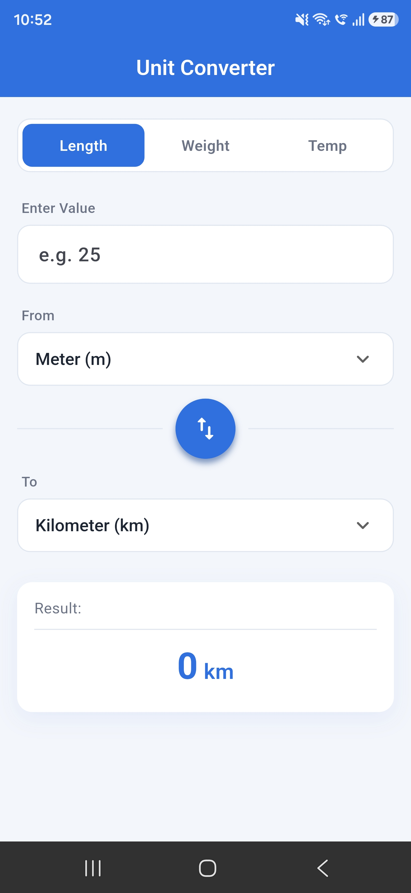
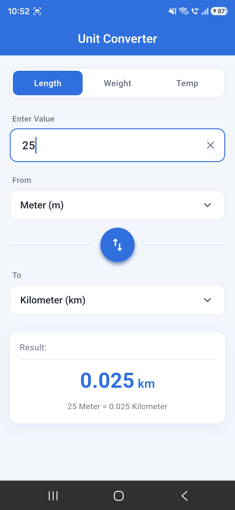
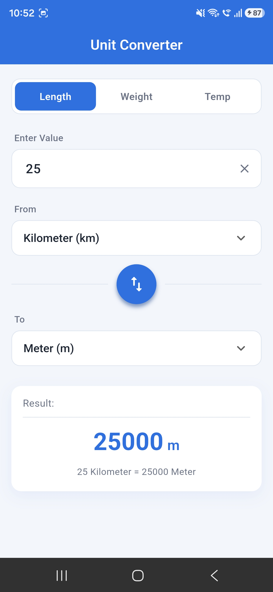
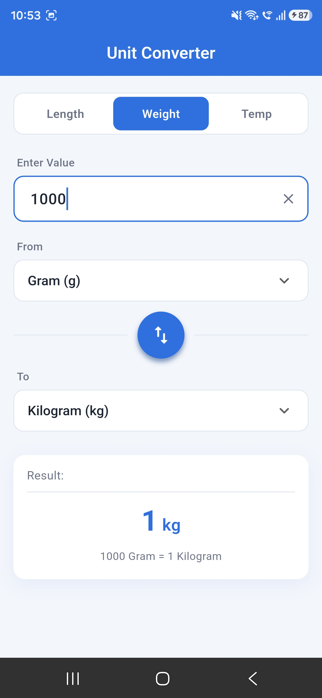
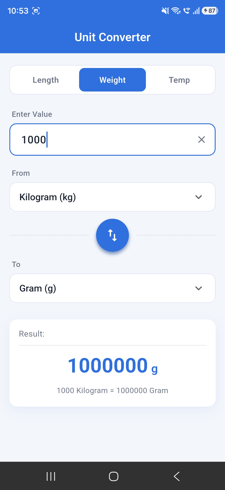
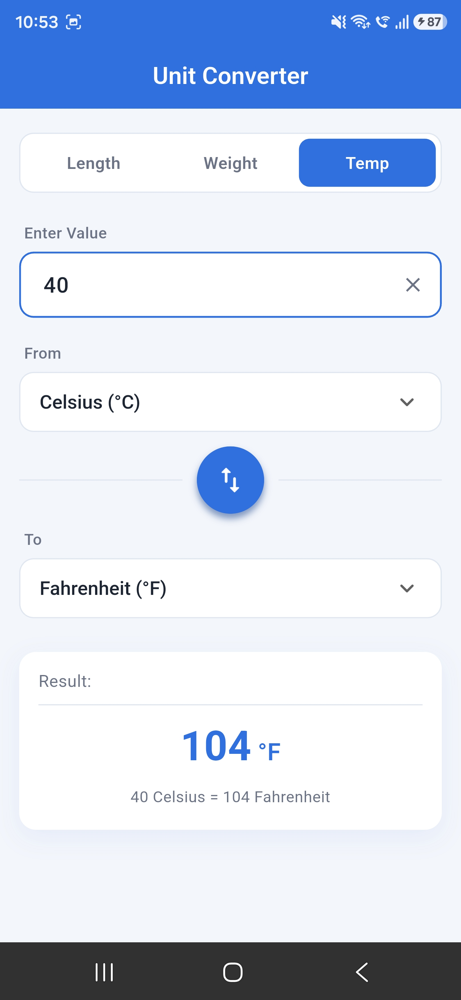
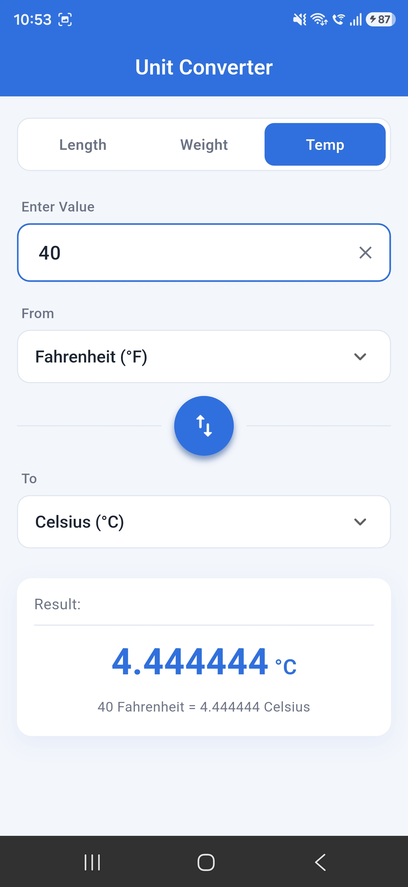

# Unit Converter App (Flutter)

This is my **Module 30 assignment** for the Ostad Flutter course. It's a simple Android app that converts **Length**, **Weight** and **Temperature** values. The result updates instantly while you type.

I built it with **Flutter** and used **Provider** for state management. I also tried to keep the code clean and organized into separate folders.

---

## Screenshots

All screenshots are from my own Android phone. They are saved in the [`output/`](output) folder.

<table>
  <tr>
    <td align="center"><br/><b>Home screen</b></td>
    <td align="center"><br/><b>Meter → Kilometer</b></td>
    <td align="center"><br/><b>Kilometer → Meter</b></td>
    <td align="center"><br/><b>Gram → Kilogram</b></td>
  </tr>
  <tr>
    <td align="center"><br/><b>Kilogram → Gram</b></td>
    <td align="center"><br/><b>Celsius → Fahrenheit</b></td>
    <td align="center"><br/><b>Fahrenheit → Celsius</b></td>
    <td></td>
  </tr>
</table>

---

## Features

- **Three categories:** Length, Weight and Temperature. You switch between them with the tabs at the top.
- **Input field:** you can type any number, including decimals and negative values (useful for temperature). A small ✕ button clears the field.
- **From / To dropdowns:** pick which unit to convert from and to.
- **Swap button:** the round blue button in the middle flips the From and To units with a small rotate animation.
- **Real-time result:** there is no "Convert" button. The result changes as soon as you type or change a unit.
- **Readable summary:** under the result it also shows a full sentence, like `25 Kilometer = 25000 Meter`.
- **Input validation:** if the input is not a valid number (for example just `-`), the app shows *"Please enter a valid number"*.
- **Clean UI:** a light blue and white theme, rounded cards and a simple layout.

---

## Conversion Logic

I wrote all the conversion formulas myself in `lib/logic/conversion_logic.dart`:

| Category    | Conversion             | Formula                     |
|-------------|------------------------|-----------------------------|
| Length      | Meter → Kilometer      | `km = m / 1000`             |
| Length      | Kilometer → Meter      | `m = km × 1000`             |
| Weight      | Gram → Kilogram        | `kg = g / 1000`             |
| Weight      | Kilogram → Gram        | `g = kg × 1000`             |
| Temperature | Celsius → Fahrenheit   | `°F = (°C × 9 / 5) + 32`    |
| Temperature | Fahrenheit → Celsius   | `°C = (°F − 32) × 5 / 9`    |

**Example from the assignment:**
Value = `10`, From = `Kilometer`, To = `Meter` → Result = **`10000 Meter`** ✅

The result is also formatted nicely. Extra zeros are removed, so it shows `10000` instead of `10000.0`, and it keeps at most 6 decimal places.

---

## State Management (Provider)

I used the [`provider`](https://pub.dev/packages/provider) package.

- `ConverterProvider` (a `ChangeNotifier`) stores the **selected category**, the **From unit**, the **To unit** and the **input text**.
- Whenever one of these changes, it calls `notifyListeners()`.
- The screen listens with `context.watch<ConverterProvider>()`, so the result is recalculated and the UI rebuilds automatically.

This is how the **real-time result** works. The UI widgets don't do any calculation; they just show what the provider gives them.

---

## Project Structure

```
lib/
├── main.dart                          # App entry point + Provider setup
├── core/
│   └── theme/
│       ├── app_colors.dart            # All colors in one place
│       └── app_theme.dart             # App theme (AppBar, inputs, etc.)
├── models/
│   ├── unit.dart                      # Unit enum (Meter, Kilometer, Gram, ...)
│   └── unit_category.dart             # Category enum (Length, Weight, Temp)
├── logic/
│   └── conversion_logic.dart          # All conversion formulas
├── providers/
│   └── converter_provider.dart        # State management
├── screens/
│   └── converter_screen.dart          # Main screen
└── widgets/                           # Small reusable UI parts
    ├── category_selector.dart
    ├── value_input_field.dart
    ├── unit_dropdown.dart
    ├── swap_button.dart
    ├── result_card.dart
    └── section_label.dart

test/
├── conversion_logic_test.dart         # Unit tests for every formula
└── widget_test.dart                   # Checks 10 km → 10000 m on the real UI

output/                                # App screenshots
```

I separated the **logic**, **state** and **UI**, so each file has one job. That made it much easier to test and change things.

---

## How to Run

**Requirements:** Flutter SDK (Dart 3), Android Studio or VS Code, and an Android phone or emulator.

```bash
# 1. Clone the repository
git clone https://github.com/ssheikhs/UnitConverter.git
cd UnitConverter

# 2. Get the packages
flutter pub get

# 3. Run on a connected Android device
flutter run
```

To build an APK:
```bash
flutter build apk --release
```

---

## Testing

```bash
flutter test
```

- **Unit tests** check every conversion formula (m↔km, g↔kg, °C↔°F) and the number formatting.
- **Widget test** opens the app, swaps to Kilometer → Meter, types `10` and checks that it shows `10 Kilometer = 10000 Meter`.

---

## What I Learned

- How to use **Provider** and `ChangeNotifier` to manage state and update the UI in real time
- How to organize a Flutter project into **models, logic, providers, screens and widgets**
- Using **enhanced enums** in Dart to keep unit data (name, symbol, category) together
- Writing **unit tests** and **widget tests** in Flutter
- Building a clean, reusable UI with custom widgets

---

## Author

**Sheikh Sazzaduzzaman**
GitHub: [@ssheikhs](https://github.com/ssheikhs)

*Ostad Flutter Course — Module 30 Assignment*
